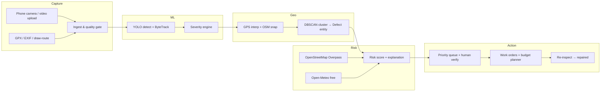

# Marga — AI-Powered Road Condition Intelligence & Maintenance Prioritisation

> *"Every road, in the order it needs you."*

**SDG 11 · Sustainable Cities and Communities**
Team DeepMinds · Kongu Engineering College · Hackatronics 2026

---

## What it is

Marga is a closed-loop road-condition intelligence platform:

**Detect → Verify → Decide → Repair → Re-inspect → Learn**

Any inspector or citizen with a smartphone can capture road footage; Marga detects potholes, cracks, and surface damage; assigns explainable risk scores; ranks a repair queue; and tracks work orders through to completion — with every number traceable to real data or clearly labelled synthetic.

---

## Architecture



---

## Quick start (local)

```bash
git clone <repo>
cd marga
make dev          # starts backend + frontend
# open http://localhost:5173
```

The app runs in **Demo mode** with seeded synthetic data if no real uploads exist.
The frontend also runs fully without the backend: `VITE_STATIC_DEMO=1 npm run dev` inside `frontend/`.

---

## How to train the model (≈ 20 clicks)

1. Open `ml/notebooks/train_yolo_rdd2022.ipynb` in Google Colab.
2. **Runtime → Change runtime type → T4 GPU → Save.**
3. Run all cells (`Runtime → Run all`).
4. Download `marga_weights.zip` from the final cell.
5. Unzip: copy `best.onnx` → `models/`, `metrics.json` → `models/eval/`.

See `ml/notebooks/train_yolo_rdd2022.ipynb` for the full walkthrough cell.

---

## Licences & attributions

- **Ultralytics YOLO:** AGPL-3.0 — this repository is open-source.
- **RDD2022 dataset:** Arya et al., "RDD2022: A multi-national image dataset for automatic road damage detection", Computers & Geosciences, 2022. [DOI pending — check dataset terms before redistribution.]
- **OpenStreetMap data:** © OpenStreetMap contributors, ODbL 1.0.
- **Open-Meteo weather:** CC BY 4.0, no API key required.
- **Depth-Anything-V2-Small** (P2, optional): Apache-2.0.
- All other dependencies: see `requirements.txt` (backend) and `frontend/package.json`.

---

## Limitations (say these to judges before they ask)

- Severity from a single camera is an **estimate**. Sizes are ±30% after lane-width calibration; depth is unknown without extra sensing.
- Water accumulation detection is labelled **EXPERIMENTAL** — supported mainly by rainfall context.
- RDD2022's India subset is good but not exhaustive; on-campus accuracy will differ. The Review queue exports corrections for retraining.
- Cost rates are **placeholder assumptions** — replace with the state Schedule of Rates.
- Marga *recommends*. A verified human *decides*.

---

## Team

DeepMinds · Kongu Engineering College · Hackatronics 2026
