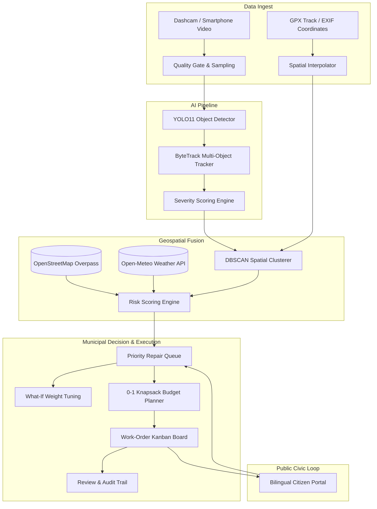

# Marga (மார்க) — Road Condition Intelligence & Maintenance Prioritisation

> *"Every road, in the order it needs you."*

[](#sdg-11-alignment)
[](https://www.gnu.org/licenses/agpl-3.0)
[](https://www.python.org/)
[](https://fastapi.tiangolo.com/)
[](https://react.dev/)
[](https://www.typescriptlang.org/)
[](https://vitejs.dev/)

**Team DeepMinds** · Kongu Engineering College · Hackatronics Hackathon 2026  
**Target Region**: Perundurai, Erode District, Tamil Nadu, India (11.2742°N, 77.5828°E)

---

## 1. What is Marga?

Potholes and road degradation cost thousands of lives and billions of rupees annually. Yet municipal maintenance teams face a fundamental decision crisis: **with finite budgets, which road defects should be repaired first?**

Existing solutions stop at detection. **Marga closes the municipal loop:**

$$\textbf{Detect} \longrightarrow \textbf{Verify} \longrightarrow \textbf{Decide} \longrightarrow \textbf{Repair} \longrightarrow \textbf{Re-inspect} \longrightarrow \textbf{Learn}$$

1. **Detect**: Ingest smartphone or dashcam video at 30 fps; run edge-optimized YOLO11 defect detection with ByteTrack persistent entity association.
2. **Verify**: Inspector & engineer verification workflow with cryptographic SHA-256 tamper-evident evidence frames.
3. **Decide**: Multi-factor Risk Scoring fusing physical severity with OpenStreetMap road exposure, pedestrian vulnerability (schools, hospitals, bus stops), and Open-Meteo rainfall telemetry.
4. **Repair**: Dynamic Programming **0-1 Knapsack budget optimizer** and drag-and-drop Work-Order Kanban board.
5. **Re-inspect**: Multi-pass DBSCAN spatial clustering connects recurring observations over time, tracking defect degradation or confirming repair completion.
6. **Learn**: Reclassified observations and field reviews feed back to fine-tune future model checkpoints.

---

## 2. Key Modules & Features

| Route | Feature | Highlights |
|-------|---------|------------|
| `/` | **Morning Briefing** | Town-wide Road Health Index (RHI), severe hazards alert, 72h rainfall context, and rapid-action shortcuts. |
| `/scan` | **Survey Processing Pipeline** | Drag-and-drop dashcam video ingest, frame sampling, CPU YOLO11 detection, and spatial interpolation. |
| `/map` | **Geospatial Survey Map** | MapLibre GL vector map with defect clusters, severity filter pins, and road health segment coloring. |
| `/queue` | **Priority Repair Queue** | Multi-factor risk ranked queue with interactive **What-If Analysis Panel** (live client-side weight tuning) and CSV / GeoJSON export. |
| `/planner` | **Budget Planner** | **0-1 Knapsack DP solver** that maximizes total risk reduction within municipal expenditure caps (₹10K–₹1L). |
| `/work-orders` | **Work-Order Kanban** | HTML5 drag-and-drop lifecycle board (*Scheduled*, *In Progress*, *Completed*, *Cancelled*) with repair cost calculations. |
| `/citizen` | **Citizen Hazard Portal** | Mobile-first, bilingual (English / தமிழ்) reporting interface with GPS lock, ticket tracking code (`MGA-CIT-XXXX`), and 4-step progress stepper. |
| `/model-lab` | **Model Lab** | Real held-out validation metrics from RDD2022 India evaluation (`metrics.json`), SVG gauge rings, and confusion matrix heatmap. |

---

## 3. Mathematical Models & Scoring Engines

### 3.1 Physical Severity Score ($S \in [0, 100]$)

Calculates the engineering damage of a single detected defect:

$$S = 100 \times \text{clamp}\big(w_A \cdot A + w_C \cdot C + w_P \cdot P\big) + \text{waterBonus}$$

- $A$: Estimated surface area ($m^2$), logistic-squashed based on calibrated lane-width camera geometry.
- $C$: Class weight ($\text{Pothole} = 1.0$, $\text{Surface Damage} = 0.8$, $\text{Transverse Crack} = 0.5$, $\text{Longitudinal Crack} = 0.35$).
- $P$: Wheel-path position penalty ($\text{Wheel Path} = 1.0$, $\text{Edge} = 0.7$, $\text{Shoulder} = 0.4$).
- $\text{waterBonus}$: $+15$ point hazard escalation for standing water pools.

### 3.2 Multi-Factor Risk Score ($R \in [0, 100]$)

Determines repair priority by factoring in human vulnerability and weather:

$$R = 100 \times \big(0.40 \cdot S' + 0.20 \cdot E + 0.15 \cdot V + 0.15 \cdot G + 0.10 \cdot T\big)$$

- $S'$: Normalized severity ($S / 100$).
- $E$ (Road Exposure): OSM highway classification ($\text{trunk} > \text{primary} > \text{secondary} > \text{residential}$) scaled by posted speed limit.
- $V$ (Pedestrian Vulnerability): Distance-decayed proximity to schools, hospitals, transit stops, and markets ($\leq 150\text{ m}$).
- $G$ (Persistence & Growth): Observation count across multi-pass surveys and physical growth trend.
- $T$ (Time & Weather): Days unrepaired combined with 72-hour antecedent and forecast rainfall from Open-Meteo.

### 3.3 0-1 Knapsack Budget Optimization

Given candidate repairs $i \in \{1, \dots, n\}$ with repair cost $c_i$ and risk reduction value $v_i$, subject to budget ceiling $B$:

$$\max \sum_{i=1}^{n} v_i x_i \quad \text{subject to} \quad \sum_{i=1}^{n} c_i x_i \leq B, \quad x_i \in \{0, 1\}$$

Solved via 2D Dynamic Programming in $\mathcal{O}(n \cdot W)$ time using ₹100 cost quantization directly in the browser.

---

## 4. System Architecture



---

## 5. Quick Start (Local Development)

### Prerequisites
- Node.js 18+ & npm
- Python 3.10+ (optional if using static demo mode)

### 1. Start Both Backend & Frontend
```bash
# Clone the repository
git clone https://github.com/deepminds/marga.git
cd marga

# Run frontend dev server (port 5173)
cd frontend
npm install
npm run dev

# In a separate terminal, run FastAPI backend (port 8000)
cd ..
pip install -r requirements.txt
python -m uvicorn backend.app.main:app --host 127.0.0.1 --port 8000
```

Open `http://localhost:5173` in your browser.

---

## 6. Fail-Safe Offline Demo Mode (`VITE_STATIC_DEMO=1`)

For hackathon presentation venues with unreliable WiFi or firewall restrictions, Marga includes a zero-dependency **Static Demo Mode**:

```bash
cd frontend
npm run dev
# Set VITE_STATIC_DEMO=1 in frontend/.env
```

The frontend immediately falls back to `/demo-data/*.json` pre-baked from the database. All algorithms—including **What-If weight adjustment**, **0-1 Knapsack budget planning**, and **data exports**—run completely client-side in the browser.

---

## 7. Model Training on Free GPU (Google Colab / Kaggle)

The training notebook is fully self-contained in [`ml/notebooks/train_yolo_rdd2022.ipynb`](ml/notebooks/train_yolo_rdd2022.ipynb):

1. Open `ml/notebooks/train_yolo_rdd2022.ipynb` in Google Colab.
2. Select **Runtime → Change runtime type → T4 GPU**.
3. Run all cells. The notebook downloads the RDD2022 India dataset, performs sequence-stratified 80/10/10 splitting, trains YOLO11n for 60 epochs with early stopping, exports to ONNX (`imgsz=640`), and evaluates metrics.
4. Download `marga_weights.zip` and extract `best.onnx` into `models/` and `metrics.json` into `models/eval/`.

---

## 8. SDG 11 Alignment

- **Target 11.2 (Safe and Affordable Transport)**: Reduces two-wheeler road accidents by identifying severe wheel-path potholes before they cause vehicular instability.
- **Target 11.6 (Reduce Environmental Impact)**: Eliminates duplicate inspection diesel van patrols through citizen-sourced hazard reporting.
- **Target 11.a (Regional Development Planning)**: Enables tier-2 and rural panchayats to optimize scarce maintenance grant allocations using mathematically optimal Knapsack scheduling.

---

## 9. Limitations & Ethical AI Notice

- **Monocular 2D Geometry**: Single-lens cameras estimate surface area ($\pm 30\%$). Water-filled pothole depth cannot be measured optically; Marga tags waterlogged defects as **EXPERIMENTAL** and requires human confirmation.
- **Dataset Generalization**: Trained on RDD2022 India subset. On-campus and unpaved rural road accuracy may vary; Marga incorporates human review overrides into its audit log.
- **Cost Assumptions**: Unit rates (e.g. ₹2,400 per $m^2$ cold-mix asphalt) are indicative presets customizable per state Schedule of Rates (SoR).
- **Guiding Law**: **Marga recommends. A verified human decides.**

---

## 10. Team DeepMinds

- **Department of Computer Science & Engineering**  
- **Kongu Engineering College**, Perundurai, Tamil Nadu, India  
- Built for **Hackatronics 2026**
